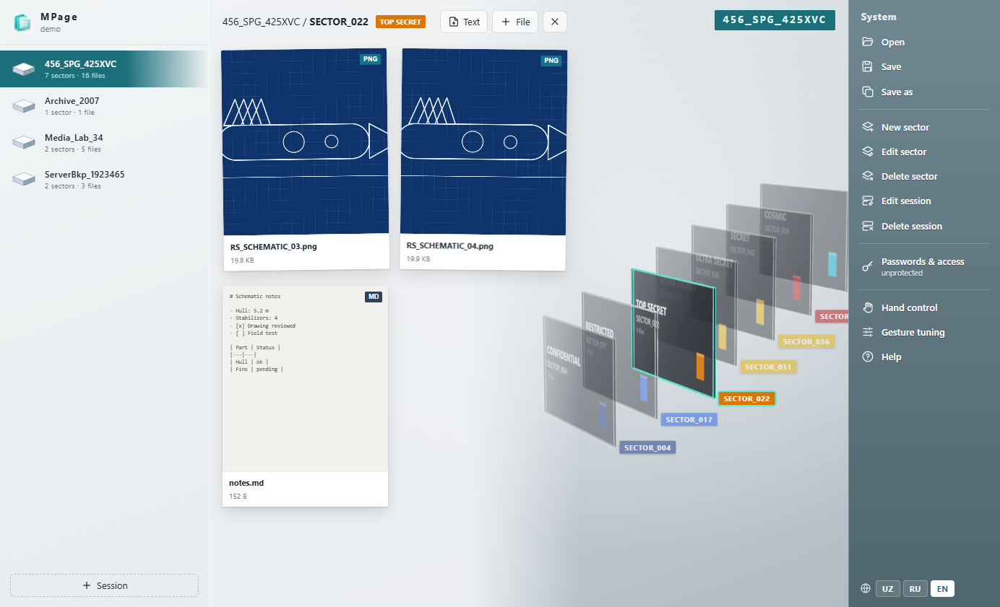
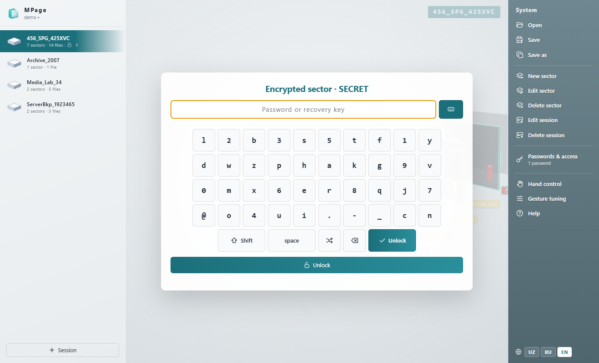

<p align="center">
  
</p>

<h1 align="center">MPage</h1>

<p align="center">
  A file manager for <code>.mpage</code> archives: any files, ordered as <b>Session → Sector → File</b>,<br>
  in a single file, with password encryption, a 3D sector view and hand-gesture control.
</p>

<p align="center">
  <a href="https://github.com/qaxxorovxd/mpage/releases/latest">Download</a> ·
  <a href="docs/MPAGE-SPEC.md">Format specification (Uzbek)</a> ·
  <a href="https://qaxxorov.uz">qaxxorov.uz</a> ·
  <a href="https://youtube.com/@qaxxorovxd">YouTube</a>
</p>



## Features

- **Ordered archive** — sessions contain sectors, sectors contain any files (PDF, images, video, audio, text, anything). File bytes are stored, not paths, so an `.mpage` keeps working on any computer.
- **Integrity** — every file carries a SHA-256 checksum that is verified on open. Already-compressed media is stored without recompression.
- **Encryption** — protect a whole session or a single sector. Different passwords unlock different parts. Argon2id (64 MiB) + AES-256-GCM; locked names are hidden too. Password change, recovery keys, auto-lock, attempt throttling.
- **3D sector stack** — sectors are glass cards colored by classification level.
- **Viewers and editors** — PDF, images, video, audio; Markdown (rendered + side-by-side editor), JSON (tree, validation, formatting), CSV (table), code and plain text. Replace any file with a newer version.
- **Hand control** — webcam gestures via MediaPipe (runs fully offline): pinch to click, palm swipes to move between sessions and sectors, fist to go back. An on-screen keyboard with shuffling keys lets you type passwords by hand.
- **Three languages** — Uzbek, Russian, English (app, CLI, error messages).
- **CLI** — `mpage pack | unpack | info | verify | protect`.



## Download

| Platform | File | Notes |
|---|---|---|
| Windows 10/11 x64 | `MPage-Setup-<version>.exe` | Installer; associates `.mpage` files. Unsigned: if SmartScreen warns, choose *More info → Run anyway*. |
| Debian / Ubuntu x64 | `mpage-viewer_<version>_amd64.deb` | `sudo apt install ./mpage-viewer_<version>_amd64.deb` — registers the MIME type and installs the `mpage` CLI. |
| Any Linux x64 | `MPage-<version>-x86_64.AppImage` | `chmod +x MPage-*.AppImage && ./MPage-*.AppImage` (needs FUSE 2: `sudo apt install libfuse2`). |

Get them from the [latest release](https://github.com/qaxxorovxd/mpage/releases/latest).

## Gestures

| Gesture | Action |
|---|---|
| Thumb + index finger | cursor |
| Short pinch | click: open a session / sector / file |
| Pinch and drag | scroll lists, rotate the stack |
| Palm swipe up / down | next / previous sector |
| Palm swipe left / right | next / previous session (or file in preview) |
| Fist (hold) | back |
| Two-hand pinch | zoom |

Thresholds can be tuned live in *Gesture tuning*.

## CLI

```bash
mpage pack folder/ -o archive.mpage        # folder/<Session>/<Sector>/<files> → .mpage
mpage unpack archive.mpage folder/ -p PASS  # .mpage → folder tree
mpage info archive.mpage                    # show the tree
mpage verify archive.mpage                  # SHA-256 integrity check
mpage protect archive.mpage --new PASS -s "Session" -s "Session/Sector"
```

Use `MPAGE_PASSWORD` instead of `-p` to keep passwords out of shell history, and `--lang uz|ru|en` to pick the language.

## Building from source

Requires Node.js 20+ (and Python 3 for the AppImage).

```bash
npm install
npm run prepare:all   # icons, MediaPipe model, renderer bundle, sample archive
npm start             # run the app
npm test              # unit tests
npm run dist:win      # dist/MPage-Setup-<version>.exe
npm run dist:linux    # dist/*.deb and dist/*.AppImage (works on Windows too)
```

The `.deb` and the AppImage are built without dpkg or squashfs-tools: `scripts/build-deb.js` writes the package directly and `scripts/mksquashfs.py` is a small SquashFS 4.0 (xz) writer.

## Project layout

```
lib/          format library: read/write, encryption, translations
cli/          command-line tool
app/          Electron app (main process, preload, renderer)
scripts/      icons, sample archive, packaging
assets/       logo (SVG source of every icon)
test/         unit tests (node --test)
```

## Security

Encryption uses well-reviewed primitives (Argon2id, AES-256-GCM via WebCrypto), but this project has not had an independent audit. There is no backdoor: a forgotten password cannot be recovered without a recovery key. Please report vulnerabilities privately via GitHub security advisories.

## Author

Created by **Axmadjon Qaxxorov** — [qaxxorov.uz](https://qaxxorov.uz) · [youtube.com/@qaxxorovxd](https://youtube.com/@qaxxorovxd)

## License

[MIT](LICENSE)
